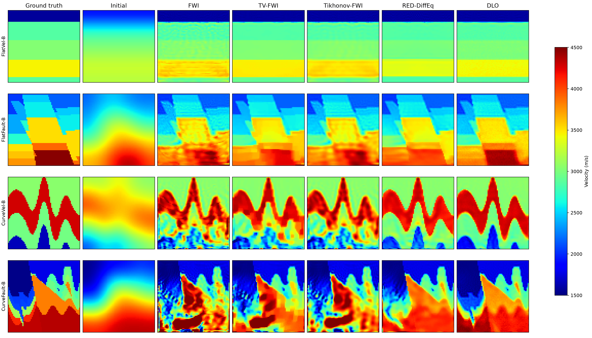

# DLO-FWI

Supplementary code for **Decoupled Latent Optimization of Diffusion Models for
Full Waveform Inversion**.

This repository provides the implementation of DLO and example inversions on
four OpenFWI datasets: FlatVel-B, FlatFault-B, CurveVel-B and CurveFault-B.



## Installation

A Linux system with an NVIDIA CUDA GPU is required. The code has been tested
with Python 3.12, PyTorch 2.11.0, CUDA 12.8 and CuPy 13.6.0.

```bash
python3.12 -m venv .venv
source .venv/bin/activate
python -m pip install -r requirements-lock.txt
```

## Pretrained models

DLO uses a pretrained diffusion model for each dataset. The weights are
available in the [model release](https://github.com/minchen073/DLO-FWI/releases/tag/v0.1.0),
with each model approximately 263 MiB. Download and install them with:

```bash
python scripts/download_weights.py --dataset all
```

The script verifies checksums and installs each model at
`checkpoints/<dataset>/model.pt`.

Weight filenames and checksums are listed in [configs/weights.json](configs/weights.json).

## Run the examples

Run DLO on the four examples:

```bash
python scripts/run_openfwi.py --dataset all --methods dlo --deterministic
```

Run DLO on a single example:

```bash
python scripts/run_openfwi.py --dataset FlatVel-B --methods dlo --deterministic
```

Use `--methods all` to include the available comparison methods and
`--output PATH` to specify an output directory.
Results include reconstructed velocity fields, comparison figures, iteration
histories and a summary of evaluation metrics.

## Examples and settings

Each example contains a 70 × 70 velocity model, seismic observations from five
sources and 70 receivers, and a Gaussian-smoothed initial model. The four
velocity models correspond to those illustrated in the paper's OpenFWI
comparison figure. Sample identifiers are recorded in
[examples/manifest.json](examples/manifest.json).

All methods use the same observations and initial model for each example.
Each method uses a fixed set of hyperparameters across the four datasets, with
300 inversion iterations. DLO uses three deterministic DDIM steps.
The complete settings are provided in [configs/openfwi.json](configs/openfwi.json).

MAE and RMSE are evaluated on normalized velocities, `(v - 3000) / 1500`.
For SSIM, normalized velocities are clipped to `[-1, 1]` and mapped to `[0, 1]`.
Metrics for the included examples are available in
[assets/reference_metrics.csv](assets/reference_metrics.csv).

## License and attribution

The code is released under the [MIT License](LICENSE).
The [OpenFWI examples](examples/LICENSE.md) and
[pretrained models](MODEL_LICENSE.md) are provided under CC BY-NC-SA 4.0.
See [THIRD_PARTY_NOTICES.md](THIRD_PARTY_NOTICES.md) for method and dependency
attribution.
